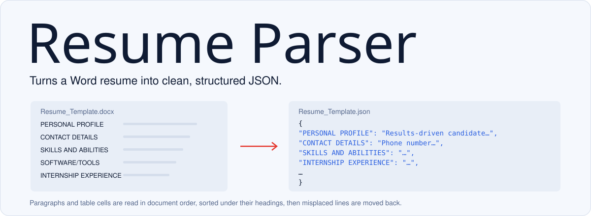

<picture>
  <source media="(prefers-color-scheme: dark)" srcset="docs/readme/banner-dark.svg">
  
</picture>

Resume Parser reads a resume written in Word and writes out JSON with one key per section: profile, contact details, skills, tools, internships, education, projects and so on. It's the first step for anything that wants to score or match resumes automatically.

## Run it

```bash
pip install python-docx
python main.py
```

Put `Resume_Template.docx` in the current folder or next to `main.py`. The script writes `Resume_Template.json` beside it. Both files in this repo are a real input and output pair, so you can see exactly what comes back.

## Why it's more than reading paragraphs

Resumes made in Word are messy. Half the content lives in tables, and lines end up under the wrong heading. So the parser:

1. **walks paragraphs and table cells in the order they appear in the document,** rather than reading all paragraphs and then all tables, which scrambles the order;
2. **recognises the section headings,** ignoring case and trailing colons, and fixes a common typo ("Postion of responsibility");
3. **repairs the result:** lines that look like education, tool lists or soft skills are moved to the section they belong in, and duplicates are dropped.

It reads `.docx` only, and it expects headings like the ones in the template. To parse a different layout, add its headings to `SECTION_HEADERS` in `main.py`.
